<div align="center">

# Flirps OS

**A Hyprland desktop for Arch Linux whose colors follow your wallpaper.**

<a href="https://archlinux.org"></a>
<a href="https://hyprland.org"></a>
<a href="https://quickshell.org"></a>
<a href="https://github.com/InioX/matugen"></a>

<br><br>

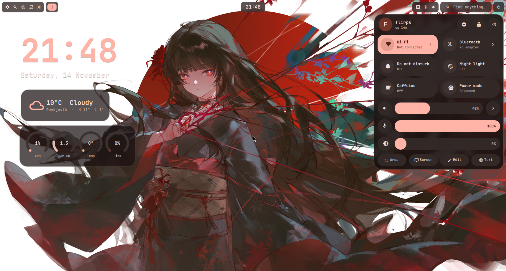

</div>

<br>

Pick a wallpaper, and the bar, panels, terminal, launcher, lock screen and login screen all recolor to match it. Everything is one [Quickshell](https://quickshell.org) shell, so it looks the same everywhere, and one script installs all of it on a fresh Arch.

## One desktop, any color

The same desktop with six different wallpapers. Nothing was changed by hand: [matugen](https://github.com/InioX/matugen) picks the palette from each image, and the bar, widgets, Quick Settings and everything else follow.

<table>
  <tr>
    <td></td>
    <td>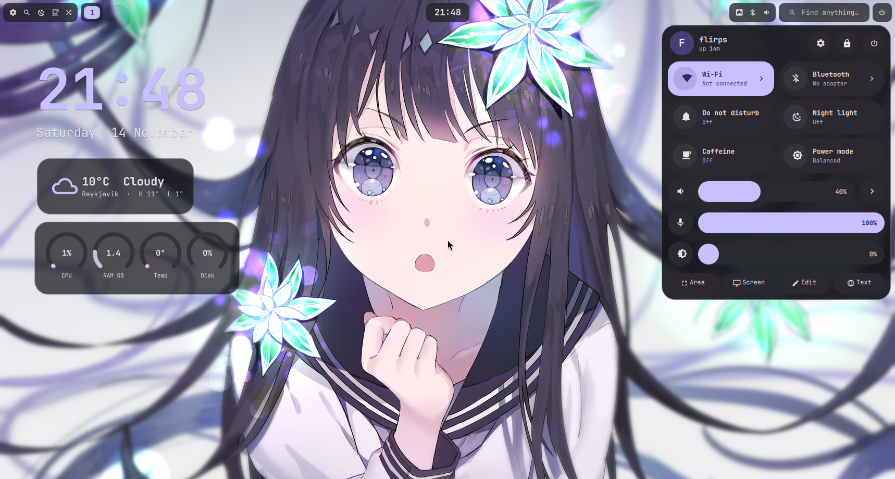</td>
    <td>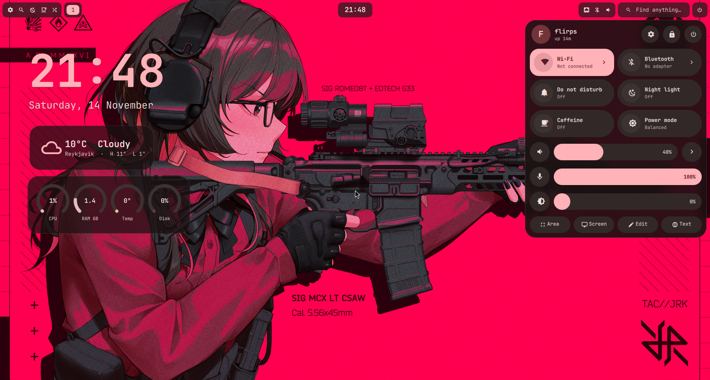</td>
  </tr>
  <tr>
    <td>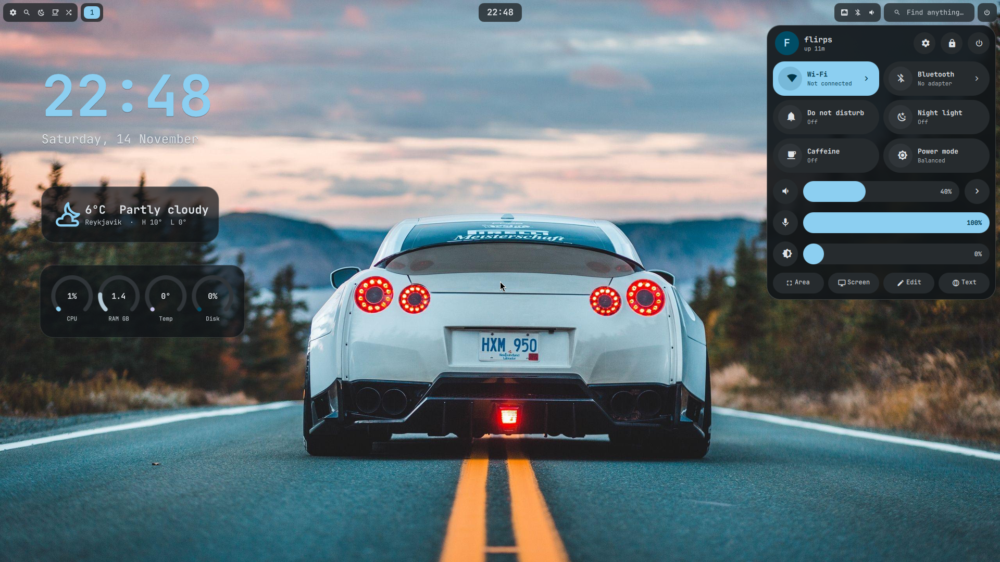</td>
    <td>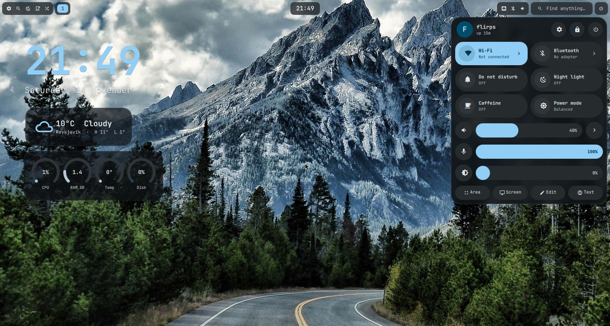</td>
    <td>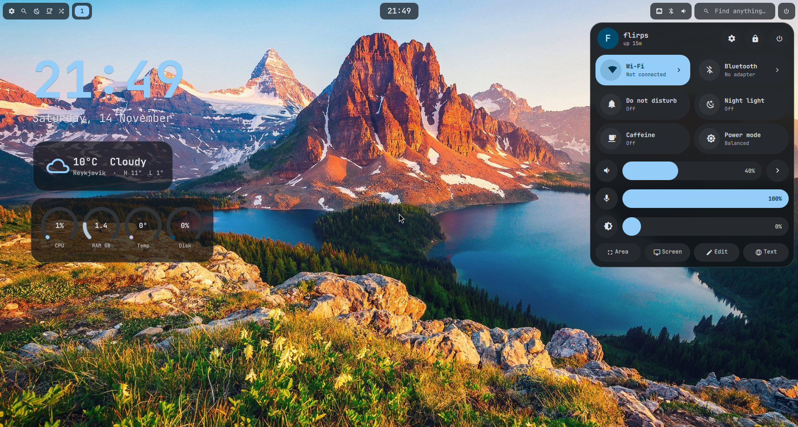</td>
  </tr>
</table>

## Previews

<table>
  <tr>
    <td width="50%">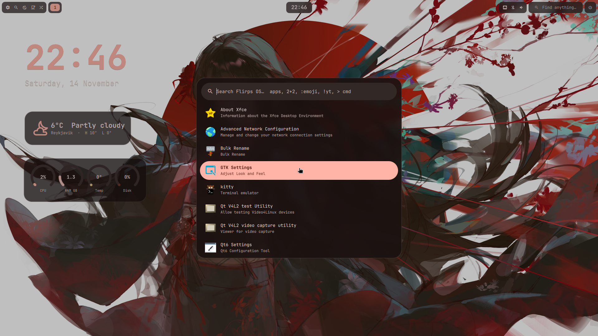<p align="center"><b>Launcher</b><br><sub>apps, math, <code>:emoji</code>, <code>!yt</code> web search, <code>&gt; cmd</code></sub></p></td>
    <td width="50%">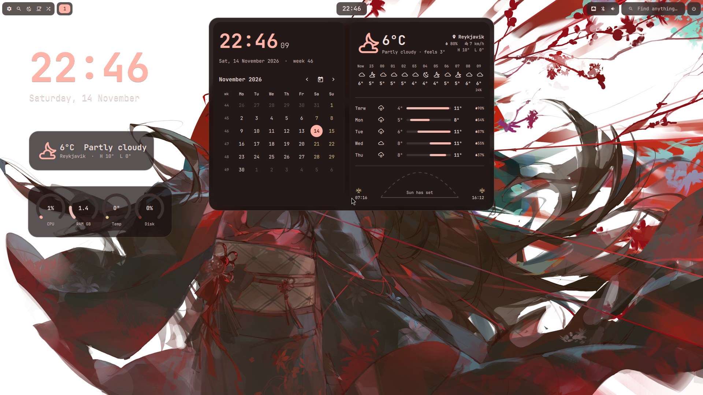<p align="center"><b>Dashboard</b><br><sub>calendar, hourly and 5-day weather, sunrise and sunset</sub></p></td>
  </tr>
  <tr>
    <td>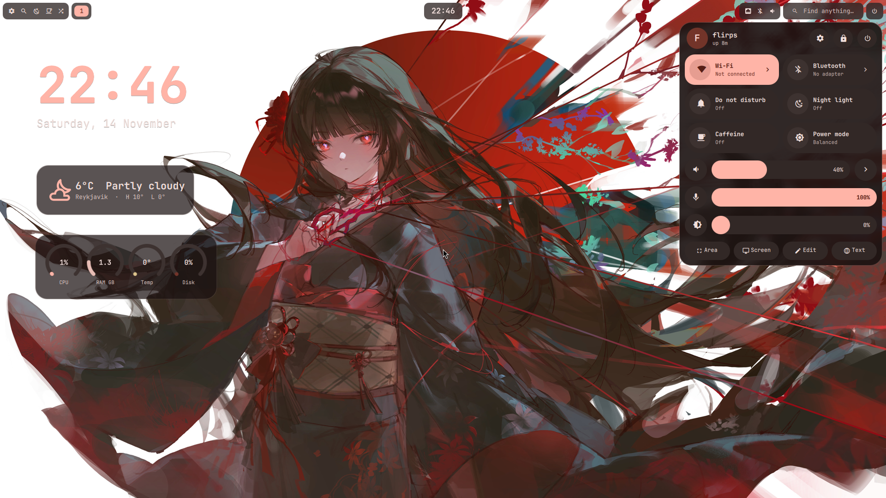<p align="center"><b>Quick Settings</b><br><sub>Wi-Fi, Bluetooth, sound, night light, caffeine, screenshots</sub></p></td>
    <td>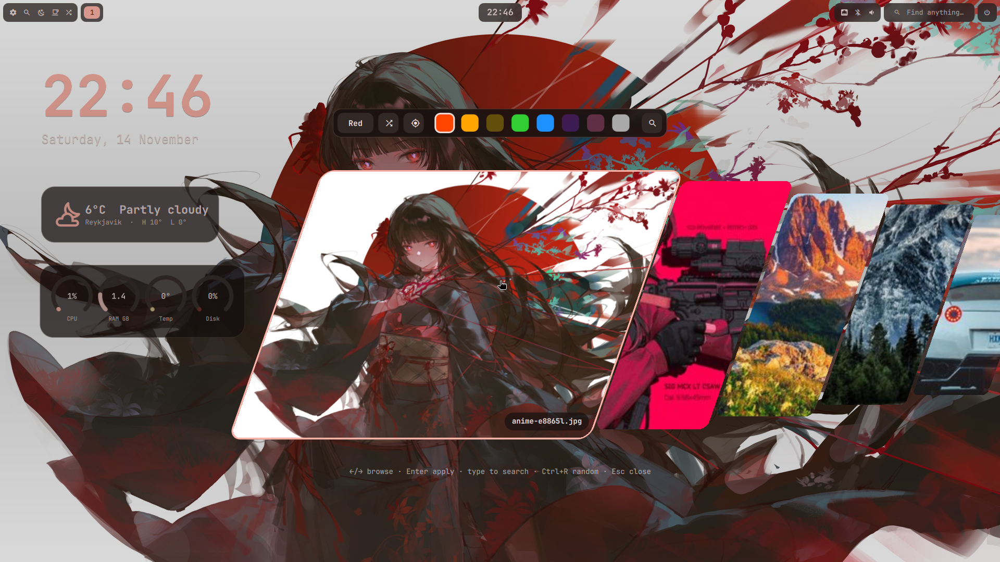<p align="center"><b>Wallpaper picker</b><br><sub>sorted by colour, with search and shuffle</sub></p></td>
  </tr>
  <tr>
    <td>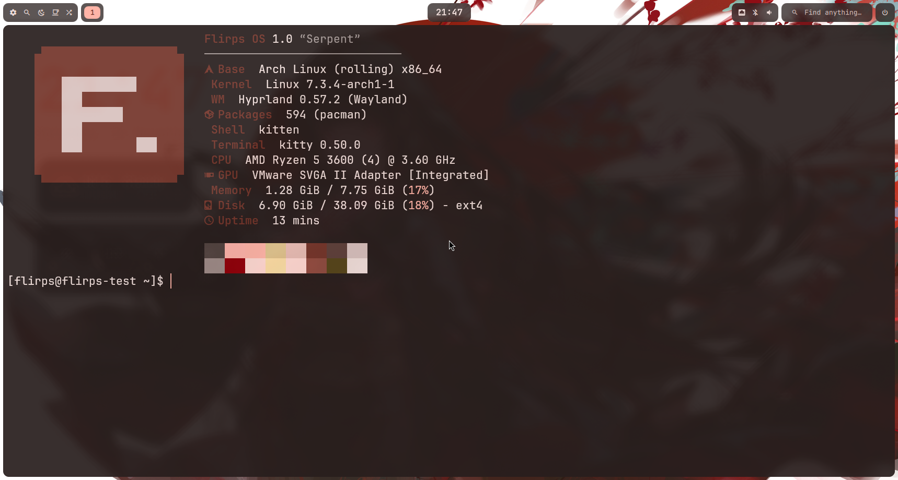<p align="center"><b>Terminal</b><br><sub>kitty and fastfetch, themed to match</sub></p></td>
    <td>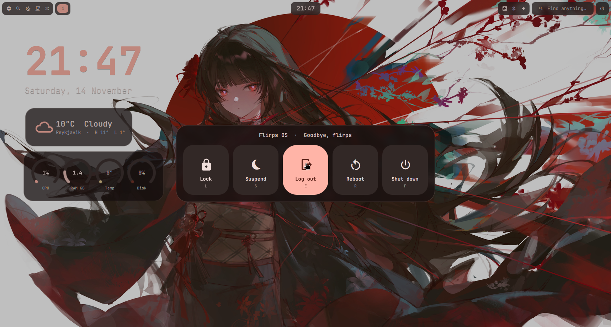<p align="center"><b>Power menu</b></p></td>
  </tr>
  <tr>
    <td>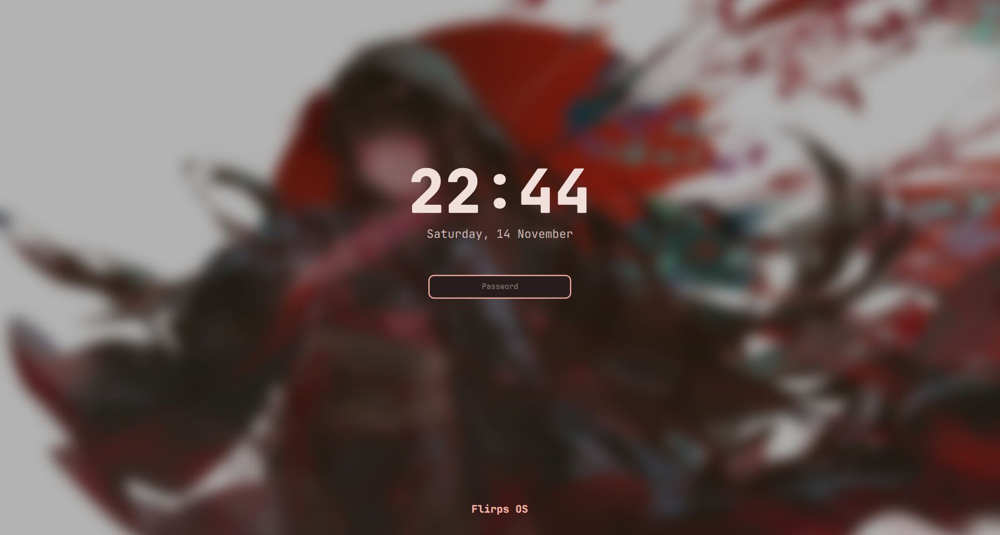<p align="center"><b>Login screen</b><br><sub>SDDM, synced to your wallpaper</sub></p></td>
    <td>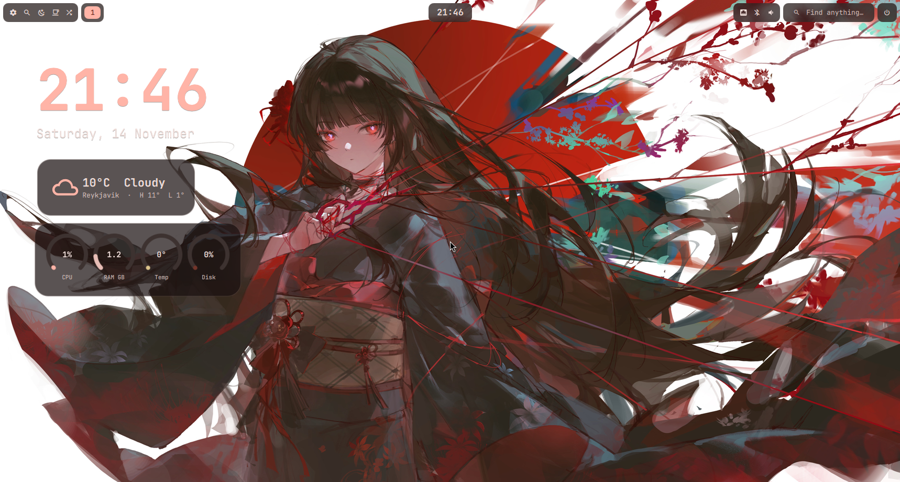<p align="center"><b>Desktop widgets</b><br><sub>clock, weather, CPU, RAM, temperature, disk</sub></p></td>
  </tr>
</table>

<sub>Screenshots are taken automatically in a VMware VM by <a href="tools/vmware-test.ps1"><code>tools/vmware-test.ps1</code></a>, so they always show a clean install.</sub>

## Features

- **Wallpaper-driven theme.** Bar, panels, kitty, GTK and Qt apps, Waterfox, hyprlock and SDDM all follow the current wallpaper. Optional automatic wallpaper rotation.
- **One shell for everything.** Bar, dock, notifications and notification center, volume/brightness popups, quick settings, launcher, dashboard, media controls, clipboard history, notes, calculator, timer, power menu, admin-password dialog and a settings app, all in Quickshell.
- **Screenshots.** Area or full screen, with an editor (satty) and text recognition (OCR).
- **Small touches.** Night light, caffeine mode, Caps/Num Lock popups, workspace gestures, and dark GTK/Qt theming.
- **One-command install.** It installs the packages, links the configs (your old ones are backed up), sets up the login screen, and reboots into the desktop.

## Install

Start from a fresh, minimal Arch install (for example `archinstall` with the *Minimal* profile) with a normal user that has `sudo`, then:

```sh
git clone https://github.com/bebdon/Flirps-OS.git ~/flirps-os
cd ~/flirps-os
./install.sh
```

It reboots when it's done (press any key to cancel). Then pick a wallpaper with <kbd>SUPER</kbd> + <kbd>W</kbd>.

| Option | What it does |
|---|---|
| `--scale 1.6` | Display scale (asked if omitted) |
| `--no-aur` | Skip AUR packages (the Waterfox browser) |
| `--no-sddm` | Don't set up the SDDM login screen |
| `--no-reboot` | Don't reboot at the end |

Existing configs that would be overwritten are moved to `~/.flirps-backup/<date>/` first. Configs are symlinked, so editing `~/.config/...` edits your clone of this repo.

### Try it in a VM first

On Windows with VMware Workstation, one command builds a VM, installs Arch and Flirps OS from your checkout, and takes the screenshots above:

```powershell
powershell -ExecutionPolicy Bypass -File tools\vmware-test.ps1
```

See [docs/vmware-test.md](docs/vmware-test.md) for options and the manual way.

## Keybinds

<kbd>SUPER</kbd> is the Windows key.

| Keys | Action |
|---|---|
| <kbd>SUPER</kbd> + <kbd>Enter</kbd> | Terminal (kitty) |
| <kbd>SUPER</kbd> + <kbd>D</kbd> | Launcher |
| <kbd>SUPER</kbd> + <kbd>F</kbd> / <kbd>E</kbd> | Browser (Waterfox) / Files (Thunar) |
| <kbd>SUPER</kbd> + <kbd>W</kbd> | Wallpaper picker |
| <kbd>SUPER</kbd> + <kbd>N</kbd> / <kbd>V</kbd> | Quick Settings: Wi-Fi / sound |
| <kbd>SUPER</kbd> + <kbd>M</kbd> | Notification center |
| <kbd>SUPER</kbd> + <kbd>C</kbd> | Clipboard history |
| <kbd>SUPER</kbd> + <kbd>I</kbd> | Settings app |
| <kbd>SUPER</kbd> + <kbd>=</kbd> / <kbd>T</kbd> / <kbd>ALT</kbd> + <kbd>N</kbd> | Calculator / timer / notes |
| <kbd>SUPER</kbd> + <kbd>A</kbd> | Show or hide the bar |
| <kbd>SUPER</kbd> + <kbd>L</kbd> | Lock |
| <kbd>SUPER</kbd> + <kbd>Q</kbd> | Close window |
| <kbd>SUPER</kbd> + <kbd>SHIFT</kbd> + <kbd>F</kbd> | Float window |
| <kbd>SUPER</kbd> + <kbd>ALT</kbd> + <kbd>F</kbd> | Maximize window |
| <kbd>SUPER</kbd> + <kbd>←↑↓→</kbd> | Move focus |
| <kbd>SUPER</kbd> + <kbd>CTRL</kbd> + <kbd>←↑↓→</kbd> | Move window |
| <kbd>SUPER</kbd> + <kbd>SHIFT</kbd> + <kbd>←↑↓→</kbd> | Resize window |
| <kbd>SUPER</kbd> + <kbd>1</kbd>…<kbd>0</kbd> | Go to workspace (add <kbd>SHIFT</kbd> to move the window there) |
| <kbd>Print</kbd> | Screenshot an area (<kbd>SHIFT</kbd>: edit it, <kbd>SUPER</kbd>: whole screen) |
| <kbd>SUPER</kbd> + <kbd>SHIFT</kbd> + <kbd>T</kbd> | Copy text from the screen (OCR) |
| <kbd>SUPER</kbd> + <kbd>Space</kbd> | Play / pause media |
| <kbd>SUPER</kbd> + <kbd>R</kbd> | Restart the shell |

All keybinds live in [`dotfiles/hypr/.config/hypr/config/keybinds.lua`](dotfiles/hypr/.config/hypr/config/keybinds.lua).

## What's inside

| Part | Used for |
|---|---|
| [Hyprland](https://hyprland.org) | Window manager, configured in Lua (`dotfiles/hypr`) |
| [Quickshell](https://quickshell.org) | The whole desktop shell (`dotfiles/quickshell`) |
| [matugen](https://github.com/InioX/matugen) + awww | Colors from the wallpaper; wallpaper transitions |
| kitty, Thunar, Waterfox | Terminal, file manager, browser |
| hyprlock, hypridle, SDDM | Lock screen, idle handling, matching login screen |

```
install.sh          the installer
packages/           pacman.txt and aur.txt
dotfiles/           GNU Stow packages, linked into $HOME
templates/          per-machine files the installer generates (monitor scale, qt6ct path)
system/             SDDM login theme and config, copied into /usr/share and /etc
wallpapers/         six starter wallpapers (~/Pictures/Wallpapers links here; ones you add stay out of git)
tools/              the automated VMware test and screenshot tour
docs/               guides and screenshots
```

## Credits

Built on [Hyprland](https://hyprland.org), [Quickshell](https://quickshell.org), [matugen](https://github.com/InioX/matugen), awww and the Arch Linux packages they depend on. Wallpapers belong to their artists.
